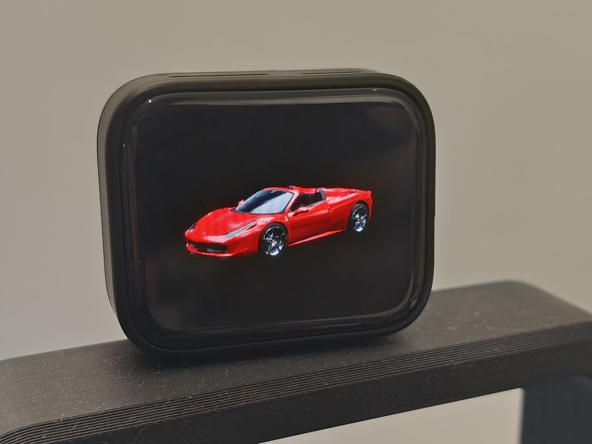
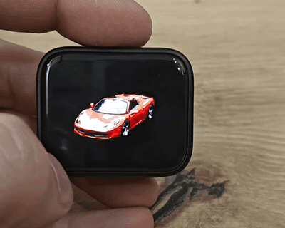

# esp32-3d-viewer — real-time 3D model viewer for the ESP32-S3 AMOLED

Smooth, studio-lit 3D car models (or any other 3D object) on a 1.8" AMOLED,
rendered in real time by a software rasterizer on the ESP32-S3. Rotate the model with
your finger or by tilting the board, switch between models with a triple tap.

<p align="center">
  
</p>

<p align="center">
  <br>
  <sub>Touch rotation with inertia, triple tap to switch models (Ferrari → Fox → Duck), settings screen. Video at 1.5× speed.</sub>
</p>

## Features

- **~30 FPS** with a 10 000-triangle model at 448×368, both CPU cores rendering
- **Studio look**: per-material "matcap" shading (clear-coat paint, glass, chrome,
  rubber, lights), baked ambient occlusion, optional edge anti-aliasing
- **Touch**: drag to rotate with inertia, double tap = reset view, triple tap = next model
- **Motion**: tilt the board left / right like a steering wheel to turn the model
  (accelerometer + gyro fusion, no drift)
- **Model packs**: up to 32 models in a 13 MB flash partition, swapped without
  rebuilding the firmware
- **Converter** for any `.glb` / `.gltf` / `.obj`: hidden-surface removal, smart
  decimation, material detection, texture-to-colour regions
- **Settings screen** (LVGL): brightness, control mode, rotation mode, landscape /
  portrait, model, auto spin, FPS counter
- **Deep sleep** on the BOOT button, wake up with the next press

## Hardware

| | |
|---|---|
| Board | [Waveshare ESP32-S3-Touch-AMOLED-1.8](https://docs.waveshare.com/ESP32-S3-Touch-AMOLED-1.8) **V2** |
| Display | 1.8" AMOLED 368×448, CO5300 over QSPI |
| Touch | CST820 (I2C) |
| Other | QMI8658 IMU, AXP2101 PMU, TCA9554 IO expander, 16 MB flash, 8 MB PSRAM |

> The V1 board (SH8601 display + FT3168 touch) is **not** supported. The version is
> printed on the label on the back of the board.

## Quick start

Requirements: [ESP-IDF 5.5.x](https://docs.espressif.com/projects/esp-idf/en/stable/esp32s3/get-started/)
(tested with v5.5.1). LVGL 9.2 is downloaded automatically by the component manager.

```bash
git clone https://github.com/v-cu/esp32-3d-viewer.git
cd esp32-3d-viewer/firmware
idf.py set-target esp32s3
idf.py build
idf.py -p COM5 flash monitor        # Linux/macOS: -p /dev/ttyACM0
```

`idf.py flash` writes the firmware **and** the model pack (`firmware/models/model.bin`)
to the `model` partition.

## Controls

| Gesture | Action |
|---|---|
| drag | rotate the model (left/right = turn, up/down = view from above/below); keeps spinning and slows down |
| double tap | back to the default 3/4 view (Motion mode: current pose becomes neutral) |
| triple tap | next model of the pack (the number, e.g. `2/3`, is shown briefly) |
| long press (0.7 s) | **Settings** |
| no touch for 6 s | slow automatic spin (can be turned off) |
| **BOOT** short press | deep sleep (screen off); press again to wake up |

**Settings**: brightness · Control (Motion / Touch) · Rotation (Free / Left-Right) ·
Screen (Landscape / Portrait) · Model · Auto spin · Smooth edges · FPS counter ·
Reset view. Everything is saved in NVS, including the selected model.

**Motion mode** works like a steering wheel: hold the board in front of you and tilt it
left or right, the model turns left or right (2.5° of model per 1° of tilt). In *Free*
rotation mode, tilting the top of the board towards / away from you also changes the
viewing height; *Left/Right* keeps only the turn.

## Models

The repository ships a pack with three demo models:

| # | Model | Triangles |
|---|---|---|
| 1 | Ferrari 458 Italia | 10 000 |
| 2 | Fox | 576 |
| 3 | Duck | 4 212 |

Single converted models are in `firmware/models/src/`, the pack that gets flashed is
`firmware/models/model.bin`.

### 1. Install the converter dependencies (once)

```bash
pip install numpy scipy trimesh pygltflib meshoptimizer fast-simplification pillow DracoPy
```

### 2. Convert a model

Download a `.glb` (e.g. from Sketchfab: *Download → glTF Binary*, check the licence),
then:

```bash
python tools/model_convert.py my_car.glb -o models/my_car.bin --name "My Car"
```

Paths are relative to the folder you run the command in. Useful options:

| Option | Meaning |
|---|---|
| `--budget 10000` | triangle count (default 10 000; more = finer but slower) |
| `--paint "#B3141E"` | override the body colour of a car |
| `--config my_car.json` | manual material assignment, up axis, rotation (see `tools/example_model_config.json`) |
| `--tex-colors 12` | textured models: number of colour regions taken from the texture (0 = off) |
| `--keep-hidden` | keep geometry that is never visible (e.g. a convertible without glass) |
| `--preview-matcaps mc.png` | save a preview sheet of the generated materials |

What the converter does automatically:

- loads the scene with node transforms, removes duplicate (double-sided) faces, fixes winding
- removes geometry that can never be seen (interior behind the glass, engine, ...)
- detects materials by name, PBR values and texture colours: paint, glass, chrome, metal,
  tyre, plastic, head/tail lights, interior, carbon
- texture atlases (windows, lights and trim in one texture) are split into colour regions
  and classified by colour **and** position: red at the rear = tail lights, white at the
  front = headlights, orange = indicators, dark above the window line = glass
- transparent lenses over the lamps are removed (the renderer has no transparency)
- finds the front of the car from the lamp colours
- decimates to the budget, giving the body most of the triangles
- transfers smooth normals from the original mesh, bakes ambient occlusion, renders a
  studio "matcap" per material

Objects that are not cars (no wheels or lights) are handled as generic objects: front
is +Z (glTF convention), scaled by their largest dimension. A model that ends up facing
backwards can be turned with `"flip_front": true` (or `"yaw_deg": 90`) in the JSON config.

### 3. Build a pack

The order on the command line is the order of the triple-tap cycle:

```bash
python tools/pack_models.py models/my_car.bin firmware/models/src/Ferrari.bin firmware/models/src/Fox.bin
```

The pack is written to `firmware/models/model.bin` by default (`-o` to change it).
Display names can be overridden with `--names "My Car,Ferrari,Fox"`. Limits: 32
models, 13 MB in total — at the default budget a model is about 300–450 KB.

### 4. Flash only the models

No rebuild needed:

```bash
cd firmware
idf.py -p COM5 model-flash
# or, without the ESP-IDF environment (from the repository root):
python tools/flash_model.py COM5 firmware/models/model.bin
```

A single model `.bin` (not packed) can be flashed the same way.

### Preview on the PC

`sim/` builds the same renderer for the PC and writes frames as PPM images (it takes a
single model, not a pack):

```bash
cmake -S sim -B sim/build && cmake --build sim/build
sim/build/r3d_sim firmware/models/src/Ferrari.bin out/f 448 368 0 72 215 5 16 1 0
python tools/preview.py out/f preview.gif
```

Arguments: `model prefix width height rotation frames yaw0 yaw_step pitch zoom reflection`.
Set `R3D_AA=1` in the environment to preview the edge anti-aliasing.

## Configuration

`idf.py menuconfig → 3D viewer configuration`:

| Option | Default | |
|---|---|---|
| Default screen orientation | 270° (landscape) | until changed in Settings |
| Display QSPI clock | 40 MHz | 80 MHz may work on some units |
| Frame rate cap | 60 | |
| IMU → screen axis mapping | `+x+y+z` | |
| Motion: invert left/right | off | if the model turns the wrong way |
| Show a red dot where the touch is detected | off | touch debugging |
| Show colour bars at boot | off | display debugging |
| Show FPS counter by default | on | |

## How it works

- **Renderer** (`firmware/components/r3d`, portable C, same code as the PC simulator):
  - band z-buffer: the screen is drawn in 32-line bands in internal SRAM; while one band
    is sent by DMA over QSPI the next one is rasterised
  - only the area covered by the model (plus where it was in the previous frame) is
    drawn and sent
  - both cores: vertex transform and triangle binning are split in halves, bands are
    handed out dynamically (work stealing)
  - fixed-point span loop, no float division (the S3 has no hardware divider)
- **Shading**: 128×128 or 64×64 matcap per material, indexed by the view-space normal,
  multiplied by baked per-vertex AO; reflections slide over the body while it turns
- **Display**: own CO5300 driver on `esp_lcd_panel_io`; a single display task owns the
  SPI bus (the IDF SPI master is not thread safe for one device used from two cores)
- **LVGL** runs only on the Settings screen and reuses the band buffers
- **Robustness**: stall detector with log output, I2C bus recovery at boot and at run
  time, task-watchdog-friendly render loop

## Project structure

```
firmware/                ESP-IDF project
  components/r3d/        renderer + model format (portable C)
  main/                  board, display, touch, IMU, controls, UI, render pipeline
  models/model.bin       model pack written to the "model" partition
  models/src/            single converted models
  partitions.csv         app 3 MB + models ~13 MB (16 MB flash)
tools/
  model_convert.py       any 3D model -> R3DM (.bin)
  pack_models.py         several models -> one pack
  flash_model.py         flash only the models
  preview.py             GIF from simulator frames
sim/                     PC simulator (CMake)
docs/                    photo and demo GIF used by this README
```

## Troubleshooting

| Problem | What to do |
|---|---|
| black screen | enable *Show colour bars at boot* in menuconfig and check the boot log |
| touch hits the wrong place | enable the red-dot option in menuconfig: it shows where touches land |
| model turns the wrong way in Motion mode | enable *Motion: invert left/right* |
| log says `I2C bus stuck low` | power the board off completely (USB **and** battery, or hold PWR ~10 s) |
| a model is too slow | convert it with `--budget 7000`, or turn off *Smooth edges* |

## Credits

Demo models, converted to the R3DM format (the original licences apply):

- **Ferrari 458 Italia** by vicent091036 (Sketchfab), as used in the three.js examples
- **Duck** and **Fox** from the Khronos [glTF Sample Models](https://github.com/KhronosGroup/glTF-Sample-Models)
  (Duck © Sony Computer Entertainment Inc., SCEA Shared Source License; Fox model by
  PixelMannen, rigging by tomkranis, CC BY 4.0)

Built with [ESP-IDF](https://github.com/espressif/esp-idf) and [LVGL](https://lvgl.io).

## License

The source code (firmware, renderer, tools and simulator) is released under the
[MIT License](LICENSE) — © 2026 v-cu.

The 3D models in `firmware/models/` are **not** covered by this licence: each one keeps
the licence of its original author (see [Credits](#credits)).
